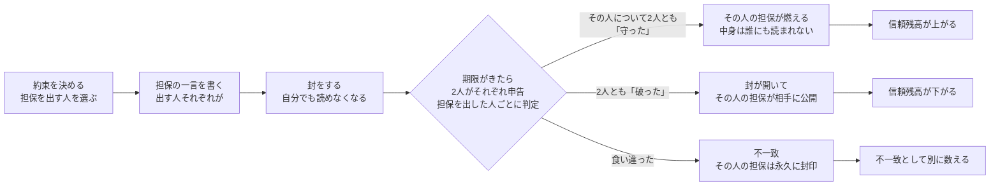

# 案出し・設計書 ― テーマ「信じる」

アプリ名（仮）：**信じてMe! ― 約束の担保**

## 1. テーマの解釈

「信じる」は、**結果がわからないものに賭けること**。
賭けに負けたとき（成立しなかったとき）に失うものがあるから、「信じる」は重くなる。失うものがなければ、それはただの「予想」。

→ **「成立しなかった時に何かが起きる」ほど、信じる行為は本物になる** という切り口で考えた。

## 2. 案出し

### 1回目：「信じる」を"確かめる"とセットにする

| # | 案 | ひとことで |
|---|----|-----------|
| A | ジンクス・ラボ | ジンクスを記録して、本当に効いているかデータで確かめる |
| B | 直感ログ | 直感を先に記録して、あとで答え合わせする |
| C | みらい手紙 | 未来の自分に手紙を書く。指定日まで開封できない |
| D | 約束バトン | 友だちとの約束を記録して、守った数を「信頼残高」にする |
| E | ちょっと待ってボタン | ニュースをシェアする前に3問でチェックする |

→ どれも「成立しなかった時」の重みが弱い、と気づいた。

### 2回目：成立しなかった時に"強い何か"が起きる

| # | 案 | 信じるもの | 成立しなかった時 |
|---|----|-----------|----------------|
| 1 | 燃える手紙 | 未来の自分 | 手紙が燃えて、二度と読めない |
| 2 | 信頼ゲーム | 相手 | 片方だけ信じると、信じた側が全部失う |
| 3 | ジンクス供養 | ジンクス | 効かないと出たら、お焚き上げで手放す |
| 4 | **約束の担保** | 他人／自分 | **預けた「恥ずかしい一言」が相手に公開される** |
| 5 | 直感ロック | 自分の直感 | 外れが続くと、その分野で直感が使えなくなる |

### 選定：4「約束の担保」

- 「約束を信じてもらう」と「相手を信じる」の両方が1つの体験に入っている
- 担保が **燃える（守った）か、開く（破った）か** の分かれ道が、そのままデモの山場になる
- 担保の内容を自分で選ぶので、重さを自分で調整できる

## 3. 課題とペルソナ

**ペルソナ**：専門学生・20歳。「明日は遅刻しない」「今週中に返す」と友だちと約束するが、破っても「ごめん」で終わる。言われる側も、もう半分しか信じていない。

**課題**
1. 口約束は、破っても失うものがないので軽い
2. 軽いから、言われた側も信じきれない
3. 「信じて」と言うだけでは、信頼は増えない

**提供価値**：約束に「担保」を入れることで、言う側は本気になり、聞く側は信じる根拠を持てる。

## 4. コンセプト

> **約束に、質（しち）を入れる。**
> 守れば担保は燃えて、誰にも読まれずに消える。破れば、封が開く。

## 5. 体験の流れ



- 担保を出す人は約束の中身で選ぶ
  - 自分だけ：自分が守る約束（例：「明日は遅刻しない」）
  - 相手だけ：相手が守る約束（例：「内定が出たら焼肉おごって」と自分が言い、守るのは相手）
  - 2人とも：2人で守る約束（例：「週末に水族館へ行こう」）。片方だけ破ったら、破った人の担保だけが公開される
- 申告では、担保を出した人それぞれについて「守った／破った」を答える（2人ともなら2問）。取り消せない。相手の答えは、結果が出るまで見えない
- 結果は担保を出した人ごとに決まる。2人の結果が分かれたら、約束全体は「結果が分かれた」と表示する
- 期限前でも申告できる（早めに守り終えた約束を閉じられる）

## 6. 機能（プロトタイプの範囲）

| 機能 | 内容 | プロトタイプ |
|------|------|:--:|
| 約束の作成 | 約束の内容・相手・期限・担保を出す人（自分だけ／相手だけ／2人とも）・担保の一言 | ○ |
| 相手の担保 | 相手も担保を出す約束では、相手が担保を書いて封をするまで「担保待ち」 | ○ |
| 封印 | 封をしたら、担保は本人にも表示されない | ○ |
| 期限の表示 | 残り時間、期限切れなら「判定待ち」、片方が申告済みなら「あと1人」。期限は候補から選ぶ（デモ用に「1分後」あり） | ○ |
| 申告 | 約束した人と相手が、担保を出した人ごとに「守った／破った」を選ぶ。人ごとに、一致で確定、食い違えば不一致。取り消せないので確認を1回挟む | ○ |
| 演出 | 全員守った → 封筒が燃える／誰かが破った → 封が開いて破った人の担保が出てくる／不一致 → 封をしたまま。結果欄に人ごとの結果を並べる | ○ |
| 信頼残高 | 自分の担保の結果のうち、守った割合。全体と相手ごと。不一致は別に数える | ○ |
| 2台で同期 | 同じWi-FiにあるPCの中継サーバー経由で、約束と申告が相手の端末に届く（約1秒ごとに取得）。名前で本人と相手を見分ける | ○（デモ用） |
| 1台モード | ネットなしで、端末を手渡しして「本人 → 相手」の順に申告 | ○ |
| 本格的な2人の仕組み（アカウント・招待・通知） | 名前ではなくアカウントで識別、プッシュ通知 | 今後 |

## 7. 画面設計

接続画面・一覧・詳細・作成の4画面を、状態で切り替える。

**接続画面**：「2台で同期する」（自分の名前・サーバーのアドレス）か「1台で使う（オフライン）」を選ぶ

**一覧**：いまのモード、信頼残高、約束の一覧。自分が作った約束は「〇〇さんと」、相手として受けた約束は「〇〇さんから」と表示

**詳細画面（上から）**
1. 約束の内容・相手・期限（残り時間）
2. 封筒（封印中／燃えた／開いた）
3. 相手の担保がまだなら、担保を書くフォーム（2台：相手の端末／1台：「相手に端末を渡してください」のあと。封をしたら「約束した人に端末を返してください」→ 受け取ってから申告へ）
4. 申告
   - 2台：自分の申告ボタン → 確認 → 「相手の申告を待っています」→ 結果がそろったら両方の画面で演出
   - 1台：本人が申告 → 「相手に端末を渡してください」→ 相手が申告 → 演出

**確認ダイアログ**：「取り消せない」「〇〇：守った → 一致すれば燃える」（人ごと）「食い違った人の担保は永久に封印」を短い行に分けて見せる

**作成画面**：約束・相手・期限・担保を出す人を選ぶ → 自分も出すなら担保の一言を入力 → 「封をする」（自分が出さないときは「約束を送る／作る」）

## 8. データ設計

```text
Promise {
  id, title(約束), creator(約束した人), partner(相手), due(期限),
  holder(担保を出す人：'self' | 'partner' | 'both'),
  selfCollateral / partnerCollateral(それぞれの担保の一言),
  selfSealed / partnerSealed(それぞれ封をしたか),
  status('active' | 'kept' | 'broken' | 'mismatch' | 'mixed'),
  selfAnswers / partnerAnswers(それぞれの答え。{aboutSelf, aboutPartner}。true=守った),
  selfReported / partnerReported(申告済みか),
  selfOutcome / partnerOutcome(担保を出した人ごとの結果。'kept' | 'broken' | 'mismatch'),
  createdAt, resolvedAt
}
```

- 表示上の状態：`active` で相手の担保がまだ → 担保待ち、期限前 → 進行中、期限後 → 判定待ち、どちらかが申告済み → あと1人
- 担保を出した人ごとに、2人の答えが一致 → `kept` / `broken`、食い違い → `mismatch`。全体の status は、全員同じならその値、分かれたら `mixed`
- 担保の中身は、その人の結果が `broken` のときだけ残す。`kept`（燃えた）と `mismatch`（永久封印）では消す
- 信頼残高 ＝ 自分の担保の結果のうち、守った数 ÷ 判定済み（`kept` と `broken`）の数。不一致は別に数える
- 保存先
  - 1台：メモリ上のみ（アプリを終了するとサンプル5件に戻る）
  - 2台：中継サーバーのメモリ上（サーバーを止めると消える）。担保の中身はサーバーだけが持ち、その人の結果が `broken` になるまで端末に送らない。相手の申告も結果が出るまで送らない

## 9. 技術構成

| 項目 | 内容 |
|------|------|
| 言語 | Kotlin |
| フレームワーク | Kotlin Multiplatform ＋ Compose Multiplatform（Android と iOS で画面のコードを共通化） |
| 対応 | Android 7.0（API 24）以上／iOS |
| ライブラリ | Compose（runtime・foundation・material3・ui）、kotlinx-datetime（期限の計算）、Ktor Client と kotlinx-serialization（同期） |
| 中継サーバー | Kotlin ＋ Ktor Server（CIO）。`./gradlew :server:run` でポート 8787。1秒ごとのポーリングで同期 |
| 画面遷移 | ライブラリなし。`Screen` の状態で切り替え |
| 演出 | 封筒は Compose の図形（GenericShape）で描画。ふたは `graphicsLayer` の rotationX、燃える演出は `drawWithContent` で下から消していく |

**ファイル構成（commonMain）**

```text
App.kt                      モードと画面の切り替え・1秒ごとの時刻更新
model/Promise.kt            約束のデータ・状態・信頼残高の計算
model/PromiseStore.kt       置き場所の共通の形、1台モード（申告・サンプルデータ）
model/RemotePromiseStore.kt 2台モード（中継サーバーとの同期）
net/Api.kt                  通信の形・HTTPクライアント・アドレスの整形
time/TimeUtil.kt            期限の計算・表示、期限の候補
ui/SetupScreen.kt           接続画面（2台／1台を選ぶ）
ui/HomeScreen.kt            一覧（モード・信頼残高・約束カード）
ui/DetailScreen.kt          詳細（封筒・残り時間・申告）
ui/NewPromiseScreen.kt      作成（入力・担保のプレビュー・封をする）
ui/Envelope.kt         封筒（封印／開封／燃える／灰）
ui/Theme.kt, Common.kt      色・共通部品
```

**中継サーバー（server/）**

```text
Main.kt         起動・API（/health, /promises, /promises/{id}/collateral, /promises/{id}/report, /reset）
ServerStore.kt  約束の保存・相手の担保の封・人ごとの一致判定・見る人ごとに隠す情報
```

## 10. 今後の検討（プロトタイプでは対象外）

| 論点 | 方向性 |
|------|--------|
| 担保の中身の精査 | 他人の悪口・個人情報・脅しに使われないよう、NGワードチェックや運営による確認を入れる |
| 判定の公平性 | 両者の申告の一致で人ごとに確定する仕組みはプロトタイプで実装済み。食い違ったときの異議申し立ては今後 |
| 公開の範囲 | 公開先は約束の相手1人だけ。拡散やスクリーンショットへの対策 |
| 2人で使う仕組み | 同じWi-Fiでの同期はプロトタイプで実装済み（名前で識別・http）。アカウント、招待リンク、通知、インターネット越しの同期と暗号化は今後 |
| データの保存 | 端末への保存（Room／SQLDelight など）、担保の暗号化 |
| 期限の入力 | 候補チップから、日付・時刻ピッカーへ |
| 約束の取り下げ | 期限前なら、相手の同意があれば取り下げられる |
