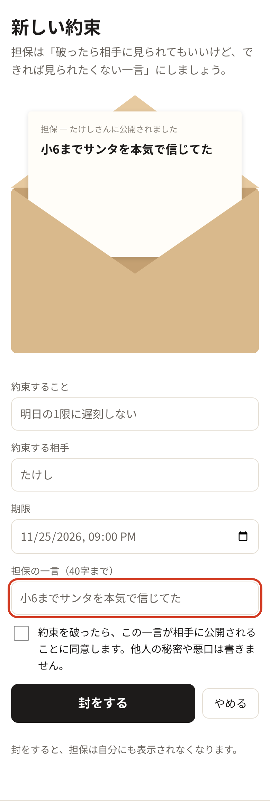
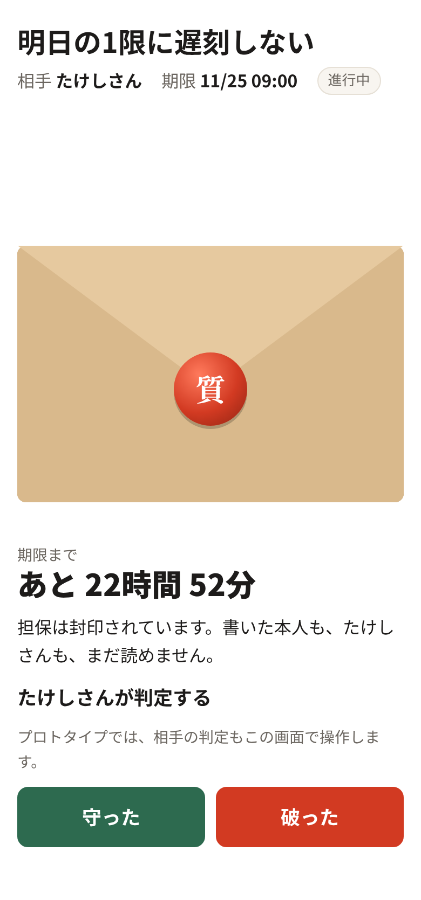
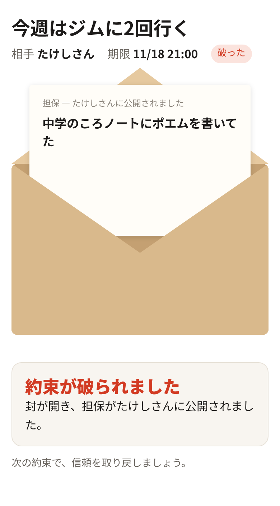

<!-- _class: lead -->
<!-- _paginate: false -->

# 信じてMe!
## 約束の担保

約束に、**質（しち）**を入れる。

ラピッドプロトタイピング ／ テーマ「信じる」

---

## テーマ「信じる」をどう捉えたか

- 「信じる」＝ **結果がわからないものに賭けること**
- 賭けに負けたときに失うものがなければ、それはただの「予想」
- **成立しなかった時に何かが起きる**ほど、信じる行為は本物になる

> 失うものがあるから、信じることは重くなる。

---

## 案出し ①「確かめる」とセットにする

| 案 | ひとことで |
|----|-----------|
| ジンクス・ラボ | ジンクスが本当に効いているか、データで確かめる |
| 直感ログ | 直感を先に記録して、あとで答え合わせ |
| みらい手紙 | 未来の自分に手紙。指定日まで開封できない |
| 約束バトン | 友だちとの約束を記録して「信頼残高」に |
| ちょっと待ってボタン | シェアする前に3問チェック |

→ どれも **「成立しなかった時」の重みが弱い**

---

## 案出し ② 成立しなかった時に"強い何か"が起きる

| 案 | 成立しなかった時 |
|----|----------------|
| 燃える手紙 | 手紙が燃えて、二度と読めない |
| 信頼ゲーム | 片方だけ信じると、信じた側が全部失う |
| ジンクス供養 | 効かないと出たら、お焚き上げで手放す |
| **約束の担保** | **預けた「恥ずかしい一言」が相手に公開される** |
| 直感ロック | 外れが続くと、その分野で直感が使えなくなる |

---

## 選んだ理由：約束の担保

1. 「約束を**信じてもらう**」と「相手を**信じる**」の両方が1つの体験に入っている
2. 担保が **燃える（守った）か、開く（破った）か** の分かれ道が、デモの山場になる
3. 担保の中身を自分で選ぶので、重さを自分で調整できる

---

## 解決したい課題

**ペルソナ**：専門学生・20歳。「明日は遅刻しない」「今週中に返す」と約束するが、破っても「ごめん」で終わる。

- 口約束は、破っても**失うものがない**ので軽い
- 軽いから、言われた側も**信じきれない**
- 「信じて」と言うだけでは、信頼は増えない

---

<!-- _class: lead -->

# 約束に、**質**を入れる。

守れば担保は燃えて、誰にも読まれずに消える。
破れば、封が開く。

---

## 体験の流れ

1. 約束・相手・期限と、**担保を出す人**（自分だけ／相手だけ／2人とも）を決める
2. 担保の一言を書いて **封をする**（書いた本人にも読めなくなる）
3. 期限がきたら、**2人がそれぞれ申告**する（相手の答えは見えない）

担保を出した**人ごとに**判定する

| その人について2人の答え | その人の担保 | 信頼残高 |
|------|------|---------|
| どちらも「守った」 | **燃える**。中身は誰にも読まれない | 上がる |
| どちらも「破った」 | **封が開く**。相手に公開される | 下がる |
| 食い違った | **永久に封印**。「この人とは約束しない方がいいかも」 | 不一致として別に数える |

「2人とも」の約束で片方だけ破ったら、**破った人の担保だけ**が開く

---

## 画面

左から

- 作成（担保のプレビュー）
- 封印中
- 破った（担保が公開）

<!-- 画像はWeb版モックの画面イメージ。実機のスクリーンショットを同じファイル名で images/ に置けば差し替わる -->

---

## 技術構成

| 項目 | 内容 |
|------|------|
| 言語 | Kotlin |
| 構成 | Kotlin Multiplatform ＋ Compose Multiplatform |
| 対応 | **Android と iOS で画面のコードを共通化** |
| 演出 | 封筒を Compose の図形で描画。ふたの回転、下から燃える演出 |
| 同期 | **同じWi-FiのPCの中継サーバー（Ktor）**で2台をつなぐ。担保はサーバーだけが持つ |
| データ | メモリ上のみ（プロトタイプのため）。1台で手渡しして使うモードもある |

---

<!-- _class: lead -->

# デモ

2台で：新しい約束（担保は2人とも）→ 封をする → 相手も封をする → 2人が申告 → **燃える／開く／不一致**

---

## 今後の課題

| 論点 | 方向性 |
|------|--------|
| 担保の中身の精査 | 悪口・個人情報・脅しに使われないためのチェック |
| 判定の公平性 | 両者の申告の一致で人ごとに確定（実装済み）。食い違ったときの異議申し立て |
| 公開の範囲 | 公開先は約束の相手だけ。拡散への対策 |
| 2人で使う仕組み | 同じWi-Fiでの同期まで実装。アカウント・招待・通知・ネット越しの同期 |

---

## まとめ

- 「信じる」を、**成立しなかった時に失うもの**から考えた
- 約束に担保を入れることで、**言う側は本気に、聞く側は信じる根拠を持てる**
- プロトタイプでは、封をする・2人で申告する・燃える／開く／不一致の体験を、2台の同期まで作った

<!-- _paginate: false -->
